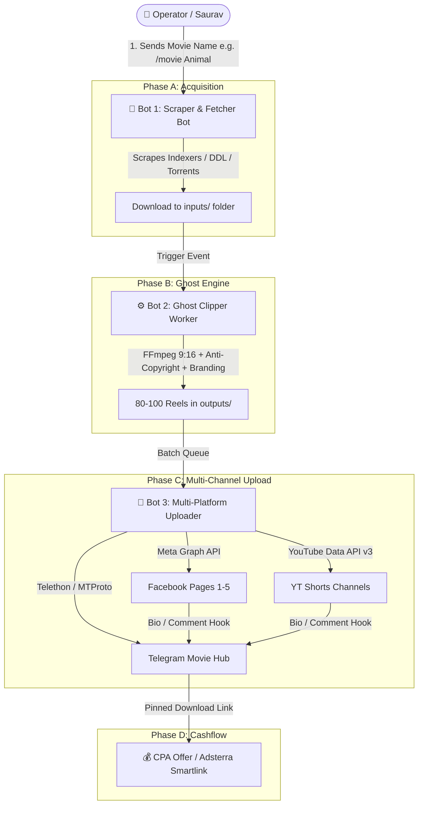

# 🤖 GHOST TRAFFIC: 3-BOT TELEGRAM AUTOMATION ECOSYSTEM

---

## The 3-Bot Role Breakdown

| Bot Component | Trigger | Tech Stack | Execution Responsibility |
| :--- | :--- | :--- | :--- |
| **Bot 1: Scraper & Downloader** | Telegram DM `/movie <title>` | Python `aiogram` + Jackett / Torrent-Aria2c / DDL Scrapers | Finds highest seed stream, downloads `.mp4` into `inputs/`. |
| **Bot 2: Ghost Slicer Worker** | `on_download_complete` Webhook | Python `engine.py` + FFmpeg subprocesses | Splits video into 75s clips, applies 9:16 blurred canvas, speed & pitch detune, exports to `outputs/`. |
| **Bot 3: Multi-Platform Distributor** | Scheduled Cron / Hourly Queue | Python `facebook-sdk` + `google-api-python-client` | Distributes 5-10 reels/day across 5+ pages/channels with rotating titles and Telegram CTA tags. |
